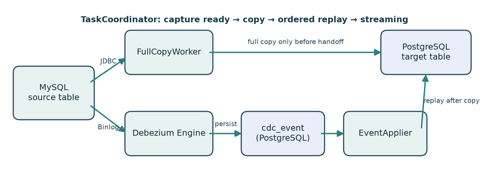
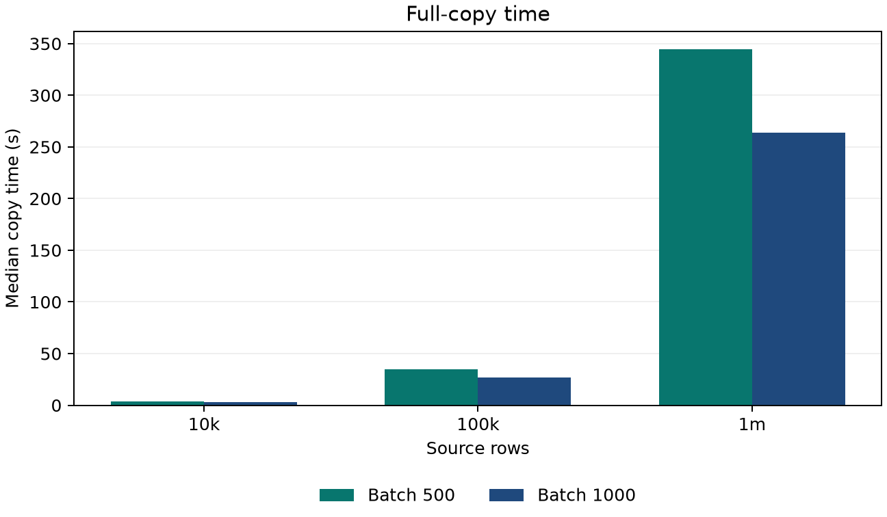
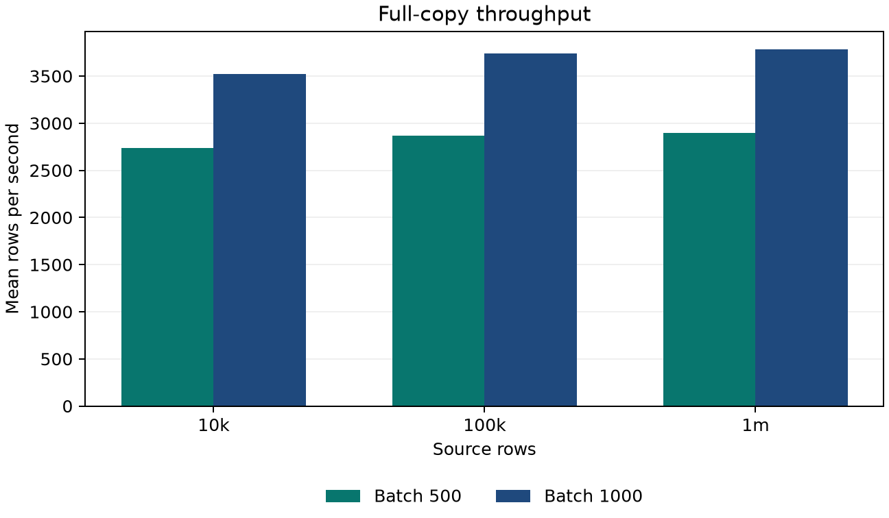
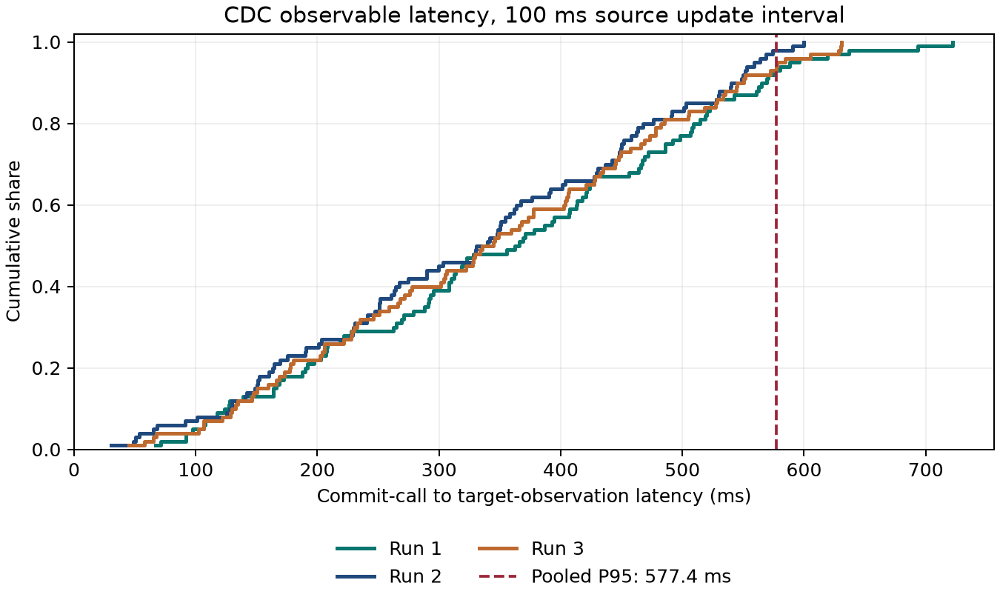

# 基于 Spring Boot 的异构数据库迁移与增量同步平台的设计与实现

> 正文技术草稿，2026-10-20。本文只写本仓库已实现、已验证的事实；全量性能、CDC 延迟和三个故障窗口重复实验已完成。可审阅的 `databridge-thesis-content-draft.docx` 由本文件生成，尚非学校模板终稿；封面、声明、目录、字号和页码须按本人的学校正式模板排版。其他同学的毕业设计仅用于观察常见章节层级，不作为本文内容来源。

## 摘要

业务系统更换数据库时，既有数据需要转移到新平台，而迁移期间源库可能继续接收写入。单纯执行一次全量复制会遗漏复制开始后的修改；简单地让全量复制和变更事件同时写入目标库，又可能发生旧的全量批次覆盖较新事件的问题。针对这一具体场景，本文设计并实现了 DataBridge：一个限定于单机、单表、MySQL 到 PostgreSQL 的迁移与增量同步平台。系统用 JDBC 按主键分批执行全量复制，以 Debezium Engine 读取 MySQL Binlog，将增量事件先写入 PostgreSQL 持久日志；全量结束后按顺序回放事件，再转入持续同步。批次写入与复制检查点、事件应用与应用游标分别位于同一目标库事务中，以支持中断后的继续处理。系统还提供源端停写条件下的双探针分块一致性校验，以及任务管理 API 和本机网页控制台。真实双库集成测试覆盖增删改衔接、重复事件、事务回滚、进程重启恢复、类型边界和差异定位。在限定表结构和同机环境中，18 次全量测量覆盖 1 万至 100 万行；批次 1000 的三种规模中位耗时分别为 2.828、26.759、264.094 秒。持续同步的 300 次更新可观察延迟合并 P50/P95/P99 为 341.292/577.380/630.625 毫秒。三个可观察故障窗口各强制终止子进程三次，重启追平后 9 次全行差异数均为零。这些结果是具体实验条件下的技术重复，不代表跨机器生产服务等级，也不证明任意时刻的跨库强一致。

**关键词：** 异构数据库迁移；变更数据捕获；MySQL；PostgreSQL；检查点；一致性校验

## Abstract

Database migration must transfer existing records while preserving changes committed during the copy. A one-time copy misses later updates, whereas concurrent full-copy and CDC writes can let an older batch overwrite a newer value. This thesis presents DataBridge, a single-process, single-table MySQL-to-PostgreSQL migration and incremental synchronization system. JDBC keyset pagination performs bounded full copy. Debezium Engine captures MySQL binary-log events and stores them durably before acknowledgment. The system replays these events in order after the copy and then continues streaming. Copy checkpoints and target writes share a transaction; event cursors and applied writes share another. A two-probe, paged verification procedure reports consistency only under a quiet-source assumption. Integration tests with real MySQL and PostgreSQL cover handoff, restart, rollback, type boundaries, and difference detection. Eighteen full-copy trials covered 10,000 to 1,000,000 rows. In 300 observed CDC updates, the pooled P50/P95/P99 latencies were 341.292/577.380/630.625 ms. Nine forced child-process terminations across three observable failure windows recovered with zero differing rows after the source stopped writing and the target caught up. These measurements are technical repetitions on one host, not a production service-level guarantee or a claim of cross-database strong consistency.

**Keywords:** database migration; change data capture; MySQL; PostgreSQL; checkpoint; verification

## 1 绪论

### 1.1 研究背景与问题

数据迁移既包含历史存量的搬运，也包含搬运期间新发生的变化。对于仍在营业的系统，源表不一定能长期停写；若全量复制从第一行读到最后一行需要数分钟，复制期间的插入、更新和删除必须被保留。因此核心问题不是“如何把两个数据库连通”，而是如何定义可靠的交接边界，以及故障后如何判断已经完成到哪一步。

常见的错误方案有两类。第一类只在某一时刻导出并导入，它无法覆盖之后的源端提交。第二类先启动 CDC，然后允许 CDC 消费者和全量复制器同时写同一目标表；即使目标写入采用 UPSERT，较晚提交的旧快照仍可能覆盖更早到达的新事件。本文选择全量期间只记录事件、暂不应用到业务目标表，然后先完成全量、再顺序回放。这个写入隔离是平台正确性的主线。

可以用一行记录说明这一问题。假设源表 `id=8` 的原值为 A：全量线程在时刻 t1 读取 A；用户在 t2 将其改为 B，CDC 在 t3 已把 B 写入目标；全量线程在 t4 才提交 A。若 t1<t2<t3<t4，目标最终仍为 A，虽然两条通道各自都没有报错。删除也有同样的竞态：CDC 删除目标行后，尚未结束的全量批次可以再次插入旧行。故“使用 UPSERT”只能解决目标主键冲突，无法替代跨通道排序；平台必须规定哪一个写入者在何时有权修改目标业务表。

本文将“正确”限定为可检验的最终状态性质：在支持的表结构、持续可用的源 Binlog 和单个后端进程条件下，源端停止业务写入，任务完成全量并消费已捕获业务事件后，源表和目标表的行主键集合及规范化字段值应相同。运行中的两端允许有传播延迟；本文不主张每个瞬间的读一致，也不提供把源库事务与目标库事务合并为一个原子提交的机制。

### 1.2 研究目标与意义

本文目标是给出一个范围明确、可运行、可复验的工程实现：在 MySQL 源端持续产生变更和服务可能中断的条件下，将单表迁移到 PostgreSQL，并在源端停写且事件追平后检查最终状态。工程重点包括：固定起始捕获边界、全量与增量无空窗衔接、幂等事件入库、事务性检查点、按序回放、可观察状态和差异报告。Debezium 负责 Binlog 解析，本文的自研部分是围绕捕获事件的存储、搬运、调度、回放与验证；不把第三方解析器的内部能力写成原创算法。

### 1.3 技术背景与相关方案

MySQL 的行级二进制日志提供事务变更的基础信息；本项目固定 ROW 格式和完整行镜像，以便更新事件有足够字段可映射。Debezium MySQL Connector 提供 `no_data` 模式，即捕获相关表结构而不复制业务数据，这使自研 JDBC 全量通道能够承担初始搬运。[MySQL 8.4 Binary Logging 文档](https://dev.mysql.com/doc/refman/8.4/en/replication-options-binary-log.html)与[Debezium 3.7 MySQL Connector 文档](https://debezium.io/documentation/reference/3.7/connectors/mysql.html)描述了相应的日志与快照机制。PostgreSQL `ON CONFLICT` 提供目标主键冲突时的更新路径，但它只解决单次目标写入的冲突，并不自动解决两条写入通道的先后顺序问题。[PostgreSQL 17 INSERT 文档](https://www.postgresql.org/docs/17/sql-insert.html)

Thalheim 与 Wang 从数据模型、模式变换和正确性验证角度研究迁移问题，提示迁移并非只复制字节，还须明确映射语义与验收性质。本文不处理任意模式变换，而是在固定字段映射下通过前置检查拒绝不兼容结构，并把关注点放到在线变更衔接与恢复。[Thalheim 与 Wang，2013](https://www.sciencedirect.com/science/article/pii/S0169023X12001048)

相关研究中的 DBLog 使用水位标记，将按块读取的全量数据与持续到来的变更事件交织处理，使日志流在回填期间仍可前进。本文同样面对“历史快照与新事件如何排序”的问题，但采用更窄的工程选择：全量期间持久保存事件、暂不把事件写到目标业务表，待全量完成后统一回放。它降低了写入竞争的复杂度，代价是全量期间目标业务表并不实时反映最新变化，且事件日志必须容纳积压；因此不应把两种方案说成同一算法。[Andreakis 与 Papapanagiotou，DBLog，2020](https://arxiv.org/abs/2010.12597)

现成迁移工具通常提供更广泛的数据源或部署选项，但本课题选择缩小功能边界，以便对正确性和故障恢复给出测试证据。它不比较未经同条件测试的第三方产品吞吐，也不推断不同数据库之间存在统一的全局事务。

从处理顺序看，本文方案与 DBLog 的取舍不同。水位交织方案在回填期间继续推进日志事件，适合需要较小回填滞后的系统，但需要处理窗口边界与冲突裁决。DataBridge 则将冲突控制移到“先持久保存、后统一回放”的阶段切换上，证明点更集中：事件是否在复制前可靠捕获、复制期间是否被禁止写业务表、回放是否保持日志顺序。代价是全量阶段的目标表只具有部分历史数据，`cdc_event` 会增长；因此应用切换必须等回放追平和校验完成，不能把处于 `COPYING` 的目标表当作业务读库。

### 1.4 研究内容与章节安排

第 2 章明确支持范围与验收条件；第 3 章描述分层架构、运行流程和持久化模型；第 4 章论证捕获就绪、分批复制、事件回放与校验算法；第 5 章介绍实际工程实现；第 6 章汇总功能测试和可重复实验；第 7 章讨论边界和扩展。所有性能指标应由 `experiments/` 下逐次原始数据计算，不由单次截图或日志推断。

## 2 需求分析

### 2.1 使用场景与角色

使用者在本机配置两个数据库的连接环境变量，预先建立与源表字段兼容、内容为空的 PostgreSQL 业务目标表，再从网页或 HTTP API 创建同步任务。系统先捕获变更，然后复制历史行、回放积压变更并维持增量同步。使用者可查看状态、检查点与事件积压，执行暂停、继续、停止，并在源端停写后发起确定性校验。首版服务仅绑定回环地址且未提供身份认证，不应暴露给局域网或公网。

该场景有两个相互分离的操作者动作。部署者负责安装双库、配置具有必要权限的数据库账号并预建目标表；使用者负责选择源表和目标表、创建任务以及观察运行状态。源库业务应用仍然是唯一业务数据生产者，平台不接管其写入请求。目标表在任务创建时必须为空，避免平台无法判断旧数据是否属于本次迁移。`sync_probe` 是平台在源库预置的控制表，服务于捕获就绪与校验屏障；它不是被迁移的业务表。

典型成功路径为：创建任务时检查结构；启动 CDC 并验证本次捕获已入日志且 offset 可读；按固定主键高水位完成全量；将积压事件应用到目标；进入持续同步；在源端停写后执行校验。失败路径同样属于需求：不兼容字段在创建阶段被拒绝；捕获未就绪不启动复制；批次 SQL 失败不推进检查点；校验期间源表发生变化时只产生 `INCONCLUSIVE` 报告，而非误报一致。

### 2.2 功能需求

| 编号 | 需求 | 可验证的验收条件 |
|---|---|---|
| F1 | 连接与结构检查 | 显示两端连接与表/列信息；拒绝不兼容主键和目标非空表 |
| F2 | 全量复制 | 按 `id` keyset 分批，固定最大主键上界，写入目标行与推进检查点同事务 |
| F3 | 增量捕获 | 读取 Binlog 的增删改事件，事件入库成功后才确认处理，重复事件由稳定键去重 |
| F4 | 无空窗衔接 | 全量期间不直接应用 CDC 到业务表；完成后按序回放再持续应用 |
| F5 | 恢复与控制 | 暂停/继续/停止可见；进程重启后从持久化位点、检查点与应用游标恢复 |
| F6 | 一致性校验 | 停写、追平时比较行数与规范化数据，报告差异行主键及列名，不泄漏字段原值 |
| F7 | 管理界面 | 浏览器展示任务、真实进度、事件积压与最近报告，不存数据库密码 |

### 2.3 非功能需求与范围

首版只支持 MySQL→PostgreSQL、单机单进程、单表、固定表结构、单列不可变有符号 `BIGINT` 主键。目标表由使用者预先创建且创建任务时必须为空。同一目标表只允许一项任务占用。进程内只允许一个任务运行；尚无跨进程运行锁，不提供多实例部署保证。系统对无法映射的列、异常 Binlog 位点和运行失败采用显式失败，不默默跳过。密码只放在未跟踪环境文件/环境变量中，HTTP 响应不回传连接串或异常原文。性能目标采用实验度量而非事先声称某个吞吐下限。

### 2.4 正确性假设与验收边界

迁移任务假设源表 `id` 不变，源端不在任务运行期间执行 DDL，源库保留完成任务所需的 Binlog，目标业务表没有外部写入者。源表与目标表的列名和可表示范围在创建时可检查，但源库连接中断、磁盘空间不足、数据库账号权限变化仍可能使运行失败。对这类条件，验收标准是可观察失败并保留已提交进度，而不是自动猜测缺失事件。尤其在 Binlog 位点不可恢复时，直接重建一个新的位点继续消费会产生数据空窗，不属于本版本的自动恢复操作。

正确性证据分三层：第一层是单元测试验证稳定事件键、类型规范化和非法参数；第二层是真实双库集成测试验证全量/CDC 交接、事务回滚与端到端目标状态；第三层是把业务任务放入子 JVM，在可观察窗口强制终止后测量恢复结果。性能实验只描述该实现的测量表现，不替代正确性测试。由于静默窗口校验采用两次探针夹住扫描，如果这段时间内记录到业务 CDC 事件，扫描结果一律为不确定；这比在源端仍变化时声称“最终相同”更符合验收边界。

## 3 系统总体设计

### 3.1 模块和数据流

DataBridge 的源端为 MySQL，目标端 PostgreSQL 同时保存业务表和 `databridge_meta` 元数据。`TaskCoordinator` 串联 `CdcCapture`、`FullCopyWorker` 与 `EventApplier`；`Verifier` 独立在持续同步阶段运行；Spring Boot 提供本机 REST API 和构建后的 Vue 静态资源。

**交接不变量：**在全量完成标记提交之前，只有 `FullCopyWorker` 写目标业务表；完成之后，全量写入器退出，由 `EventApplier` 按 `sequence` 顺序处理事件。该隔离避免两个写入者互相覆盖。事件入库与 Debezium offset 的刷盘并非同一 PostgreSQL 事务，因此系统不宣称跨组件端到端 exactly-once，而是利用稳定事件键和目标端幂等回放抵御重发。

运行路径可以分为控制面和数据面。控制面负责创建任务、状态转换、读取进度及报告；数据面有三个消费者：读取 MySQL 行的全量复制器、接收 Debezium 事件并写 `cdc_event` 的捕获器、从事件表读取并写业务目标表的应用器。两者共用一个 PostgreSQL 实例，但元数据放在 `databridge_meta` schema，业务表放在用户预建 schema，便于明确“平台状态”和“迁移结果”的所有权。`TaskCoordinator` 只决定何时调用数据面，不把进程内变量当作唯一进度来源。

图中的箭头并不表示一个跨库事务。MySQL 提交在源端完成后，CDC 事件才能被捕获；事件存储和目标应用又分别经过 PostgreSQL 事务。因此一段时间内源/目标不同是预期行为。平台追求的是保留事件与可恢复回放，在源端停写后收敛到同一可比较状态。若源库在高水位确定前已有新行，这些行可能进入全量扫描；相同源行随后出现在 CDC 日志中时，按源端顺序回放的较新状态覆盖全量结果。

### 3.2 元数据模型

Flyway V1—V5 在 `databridge_meta` 下建立五类核心记录。`cdc_event` 按任务保存事件顺序号、稳定键、源 partition/offset、操作类型、主键及更新后行；`(task_id,event_key)` 唯一约束去重。`full_checkpoint` 保存一次全量的固定高水位、最后复制主键和完成标记。`event_cursor` 保存最后成功应用的事件顺序号。`sync_task` 保存源/目标表及任务状态，同一目标表有唯一约束。`verification_run` 与 `verification_diff` 保存校验状态、统计量、差异主键和列名，不保存业务原值。数据库迁移版本随源码只追加；Spring Boot 的 Flyway 初始化机制见[3.5 版官方文档](https://docs.spring.io/spring-boot/3.5/how-to/data-initialization.html)。

**表 3-1 关键持久状态及其提交边界**

| 记录 | 关键字段或约束 | 产生者与作用 |
|---|---|---|
| `sync_task` | `task_id`、状态、源/目标标识；目标二元组唯一 | 创建/状态控制；防止在同一目标表重复建任务 |
| `full_checkpoint` | `high_watermark`、`last_id`、`completed` | 与目标行同事务提交，决定重启后的下一批范围 |
| `cdc_event` | 自增 `sequence`、稳定 `event_key`；任务内键唯一 | 捕获器先持久化事件，再向 Engine 确认 |
| `event_cursor` | `last_sequence` | 与业务事件应用同事务提交，避免“结果已变而进度未变”的不可判定状态 |
| `verification_run`/`verification_diff` | 结果状态、计数、差异 `id` 和列名 | 保存可复查报告，最多采样 100 条差异，不存业务字段值 |

`sequence` 是目标端入库后分配的单调事件编号，作为应用器的读取顺序；`event_key` 则识别同一源事件的重复投递，两者不是同一个概念。Debezium 的 offset 状态由其 JDBC 存储管理，不与平台的事件表共享一个原子事务。因而在进程崩溃附近可能重新收到同一源事件：唯一键让重复写事件日志变成无害冲突，应用游标又使已提交的日志前缀不会被任意跳过。这里给出的是本任务约束下的恢复机制，而非分布式事务意义上的“恰好一次”。

### 3.3 任务状态

任务从 `CREATED` 启动进入 `CAPTURING`，当前 CDC Engine 捕获就绪后进入 `COPYING`，全量结束转为 `REPLAYING`，积压事件追平后成为 `STREAMING`。`PAUSED` 保留 CDC 捕获而停止新的复制/应用批次，恢复后回到应有阶段。`STOPPED` 和 `FAILED` 分别表示人工停止及异常失败；失败记录阶段和净化后的异常类型/SQLState。进程启动时只恢复唯一一个持久运行任务，避免同一实例并发执行多个任务。

状态名称反映操作阶段，不应把 `STREAMING` 理解成“每一行与源端同时相同”。`REPLAYING` 到 `STREAMING` 的条件是应用器某次查询暂时没有待处理事件；之后若有新提交，仍由同一应用器继续消费。暂停调用与运行批次使用进程内锁同步，返回后不再启动新的复制或应用批次，但 Debezium 继续向事件日志写入，故暂停较久可能增加待处理事件数。停止调用等待运行器及 Engine 退出；服务异常退出后由持久状态判断是否需要继续，而不是依赖内存中旧线程是否存在。

### 3.4 故障模型与不变量

系统将故障分为“可重试的进程中断”和“前提被破坏”。前者包括在批次之间、事件已入库尚未应用、目标应用事务尚未提交时子进程消失；后者包括源 Binlog 丢失、表结构改变、目标被外部写入或多后端并发运行。当前实现通过目标 PostgreSQL 事务和事件去重处理前一类；后一类需要显式失败或人工处置，不能据已有实验证明自动修复。

可供代码与实验检查的四条不变量是：其一，全量未完成时事件只入日志不写业务目标表；其二，目标行和 `last_id` 同时提交；其三，应用事件和 `last_sequence` 同时提交；其四，校验结果只有在两个探针都被应用且其间没有业务事件时才允许判定一致或差异。这些约束也决定测试设计：分别注入写入失败、重复投递、游标阻塞和源端竞争，而不是仅检查最终页面状态。

## 4 关键模块详细设计

### 4.1 建任务前置检查

`TaskPreflight` 对源表和目标表检查主键、字段类型与目标是否为空。主键必须是单列有符号 `BIGINT id`，禁止复合键和主键修改。首版映射支持有符号整数、文本、定点数、JSON 与指定时间类型；精度、长度或时间语义不兼容时应拒绝任务，而不是截断字段。MySQL `DATETIME` 作为无时区墙上时间；`TIMESTAMP` 在 UTC 会话下读出，再写 PostgreSQL `timestamp without time zone`。这种约定不等同于跨库时区自动推断，需要在论文和操作手册明确。

前置检查不仅是改善报错的用户体验，也是使后续算法成立的条件。单列 `id` 允许复制器使用严格递增的 keyset 游标；不可变主键确保一次行更新不会跨越已复制和未复制的扫描边界；空目标表让初始写入语义明确。检查还验证源端 `sync_probe` 的 `BIGINT` 自增主键、`CHAR(36)` 标记列及可读性。目标字段类型必须容纳源字段的精度：例如定点数需同时容纳整数位和小数位，时间列精度不得小于源列。目标若多出不能映射的字段也会被拒绝，而不是默默置空。

这种检查发生在建任务时，也会在全量批次读取前检查列结构，因而可以尽早发现部分运行中变更。但它不是在线 DDL 跟踪协议：即便存在检查，创建和执行之间依然可能发生未受控的外部 DDL。项目规定运行期固定 schema，故不以“检查过一次”代替部署约束。

### 4.2 当前捕获就绪判定

Engine 启动或 `no_data` 快照结束并不证明本次连接已经保存可恢复 offset。为此，项目在 MySQL 预置 `sync_probe` 表。每次启动或恢复收到快照通知后，写入一个新的 UUID 标记；只有该标记的 CDC 事件已进入目标日志，且本任务的 JDBC offset 存在，才允许全量/回放继续。探针事件参与顺序游标但不写业务表。这避免把固定睡眠时间、其他任务的 offset 或一次性快照通知误当成就绪证据。

这里区分三个不同事实：Engine 线程已启动、当前任务源端探针已通过事件处理器进入目标日志、当前任务的 offset 存储记录已经存在。只有后两项同时满足，才能把复制起点放在本次捕获之后。若仅用“线程启动后休眠若干秒”，调度慢时会出现读历史行之前 CDC 尚不可恢复的空窗；若仅检查数据库里存在任意 offset，也可能误读前一任务的记录。实现为每个任务生成独立连接器名称和 topic 前缀，并在等待循环中检查本次随机标记及对应 offset。等待超时或探针表缺失时任务失败，不启动全量。

### 4.3 全量复制与故障恢复

首次批次读取源表 `MAX(id)` 作为高水位。之后按 `id > last_id AND id <= high_watermark ORDER BY id LIMIT batch_size` 查询；第一页省略下界。稀疏主键不影响扫描终止，后插入且大于高水位的行交由 CDC 捕获。每批在 PostgreSQL 一个事务内执行 UPSERT 并更新 `full_checkpoint.last_id`。若写入失败，检查点与目标行同时回滚；若进程在提交后退出，重启从已提交主键继续。返回空批时记录 `completed=true`，此后不再让全量写入器修改该任务的业务表。

固定上界的目的不是得到事务一致的源端快照，而是保证扫描可终止：如果任务执行期间不断插入更大的主键，单纯扫描到表尾可能永远结束不了。位于高水位以内的新写入、更新或删除由 CDC 日志在全量后重新应用；高水位以外的新行也由 CDC 补齐。因此算法依赖“CDC 在固定高水位之前已就绪”，不能把顺序反过来。对空源表，`MAX(id)` 为空，检查点直接置为完成状态，后续新行只走 CDC。

若主键稀疏，例如已有 `1, 10, 100000`，`last_id` 存的是本批真正读到的最后一个 `id`，而不是本批行数。按 `id > last_id` 查询可以跳过大段不存在的键，扫描代价与返回行及索引访问相关，页面上也不能将 `last_id / high_watermark` 当作“已迁移行数占比”。本文界面只展示真实的上界、最后主键和完成标记。

### 4.4 事件持久化和回放

`EventKey` 将源 partition、offset、表名、操作和行主键做稳定序列化并计算 SHA-256；相同源事件重发得到同一键，由数据库唯一约束去重。`CdcCapture` 在事件成功提交到 PostgreSQL 后才向 Debezium 确认。`EventApplier` 只在全量完成后按日志顺序号处理 `c/u/d`；每批目标业务变更与 `event_cursor.last_sequence` 在同一事务提交。失败批次不推进游标，重试仍从原位置开始。持续同步与回放使用同一应用器，差别仅是积压量与任务状态。

事件处理可拆成两个可恢复边界。捕获边界先把一批 Debezium 记录映射为业务事件或探针事件，再在 PostgreSQL 写入；插入成功后才调用处理确认。若在插入之后、确认之前进程消失，重启可能再次收到原事件，但同一 `event_key` 被任务内唯一约束合并。应用边界先读取 `sequence > last_sequence` 的有序前缀，按事件操作对业务表 UPSERT 或 DELETE，最后把该批尾部序号写入游标并提交。任何 SQL 失败都回滚该事务；进程中断后要么整批已提交，要么从原游标重试。探针也占据日志顺序，应用时只推进游标，不产生业务目标行。

该设计需要说明“顺序”的适用范围：当前只允许单个业务表、单个有序处理线程和一个活动任务运行器。`sequence` 表示本应用捕获入库顺序，不是任意跨源、跨连接器的全局时间戳。未来若扩展多个并行 Engine 或多节点消费者，不能照搬目前的游标机制而仍声称顺序保证。

两条通道在输入侧不强行复用同一个映射函数：全量从 JDBC `ResultSet` 读取 Java 类型，增量从 Debezium JSON 还原字段值；两者都必须满足预建 PostgreSQL 目标表的字段名、类型、精度和空值契约，且使用 UPSERT 或按主键删除。`FullCopyWorkerIT` 和 `EventApplierIT` 对有符号整数边界、定点小数、Unicode、JSON、NULL 与微秒时间做对应断言，`EndToEndSyncIT` 在真实双库上验证“旧全量值被后续增量覆盖”。这一测试组合降低适配漂移风险，但不构成任意字段值的形式化等价证明。

### 4.5 静默窗口一致性校验

确定性校验要求源端停止业务写入、任务处于 `STREAMING` 且无其他目标表写入者。`Verifier` 先写第一个探针并等待应用游标越过该探针，再对两端按 `id` 分页合并比较，最后写第二个探针并再次等待。若两个探针之间出现业务事件，报告 `INCONCLUSIVE/SOURCE_CHANGED`，不得据此宣称一致或差异确定。若任一探针超时或扫描失败，也报告 `INCONCLUSIVE` 与原因码。正常比较结果为 `CONSISTENT` 或 `DIFFERENT`；差异分为目标缺行、目标多行、同主键值不一致。逐行字段先经 `RowCanonicalizer` 规范化，再比较指纹，并最多保存 100 条差异主键和列名，避免报告泄漏业务原值。

双端扫描均以 `id` 升序分页，比较器维护两个当前行。如果源端 `id` 较小，说明目标缺行；目标端 `id` 较小，说明目标多行；主键相等时比较规范化字段和指纹，然后分别推进两端。与把两端所有行加载到内存相比，分页合并只保留当前批次及有限差异样本。扫描返回源/目标行数和全部差异行数；“最多 100 条”仅限制报告明细，不截断差异总数。

字段规范化处理了跨数据库表示差异：定点数去除不影响数值的尾随零，JSON 对象键按名称排序而保留数组顺序，文本使用 Unicode NFC，时间按项目既定墙上时间语义处理；`NULL` 与空字符串通过带标记的指纹输入区分。指纹用于快速判断同主键行是否不同，发现不同后再列出差异列名。该逻辑只覆盖预检允许的字段类型；不支持类型若强行加入扫描，不能据此得到可靠的一致性结论。

双探针的逻辑条件也必须写清：第一个探针已经被应用，才开始读取双库；扫描结束后再发送并等待第二个探针应用；查询两探针序号之间是否存在该业务表的 CDC 事件。若有则标记 `SOURCE_CHANGED`，并清除行数及差异数的确定性结论。这个屏障证明的是 CDC 在两端扫描前后均已推进到可观察位置，而非创建了 MySQL 与 PostgreSQL 的共同数据库快照。它依赖源端停写、目标无外部写入者及 CDC 健康；若屏障超时、任务状态变化或扫描失败，同样只能得到 `INCONCLUSIVE`。

## 5 系统实现

### 5.1 开发与运行环境

后端按 Java 21 目标编译，本机实测 JDK 23.0.2、Maven 3.9.16；使用 Spring Boot 3.5.16、Debezium 3.7.0.Final、MySQL 8.4.11、PostgreSQL 17.11。前端为 Vue 3.5.44、Vite 8.3.4 和 Element Plus 2.14.7。Docker Desktop 运行在 Windows 的 WSL2 后端，开发双库由 Compose 启动。数据库密码仅保存在本机未跟踪的 `infra/.env`，公开仓库只有示例配置。

工程分为 `backend/`、`frontend/`、`infra/`、`experiments/` 和 `docs/`。后端按业务责任分包：`copy/` 实现表描述与全量批次，`cdc/` 实现捕获、事件日志及应用，`task/` 实现前置检查、任务状态与 HTTP 控制，`verify/` 实现探针屏障、规范化比较和报告。这样的划分使每个包都可以用真实双库集成测试验证，而不会把“controller/service/repository”作为与业务无关的全局目录层级。`db/migration/` 内的 Flyway 脚本只追加版本，运行时自动准备平台元数据 schema；用户业务表仍须人工预建。

`infra/` 中的 Compose 仅用于开发和演示，MySQL 通过 `127.0.0.1:3307`、PostgreSQL 通过 `127.0.0.1:15433` 暴露给本机。选择非默认 PostgreSQL 主机端口是为了避开此 Windows 设备上的动态保留端口冲突，不属于系统算法要求。Docker 数据保存在命名卷中，不把活动数据库文件放到 Windows 工作区；容器数据卷和 `work/` 临时产物不进入公开仓库。`experiments/` 则保存可重算的小体量逐次 CSV、汇总脚本和论文图，而百万行种子与临时容器只在运行时存在。

### 5.2 后端接口与页面

任务 API 提供创建、列表、读取、启动、暂停、继续和停止；进度接口读取持久检查点、捕获/应用事件数和积压数，不通过稀疏主键的最大值伪造百分比。目录接口只读双库表与列元数据，单端失联仅反馈 `reachable=false`。校验 API 创建并查询报告，也可读取最近 20 份历史。构建后的前端资源由同一 Spring Boot 实例服务；默认监听 `127.0.0.1:18080`。网页可在 375px 到桌面宽度下完成任务创建、控制、进度查看和报告浏览。

**表 5-1 本机管理 API 的主要资源**

| 请求 | 作用 | 主要返回信息 |
|---|---|---|
| `GET /api/catalog` | 读取可见源/目标表与列元数据 | 两端可达性和结构摘要 |
| `POST /api/tasks` | 预检并创建单表任务 | 任务 UUID 与初始状态 |
| `GET /api/tasks/{taskId}/progress` | 读取持久进度 | 高水位、最后复制主键、事件总数/已应用数/待处理数 |
| `POST /api/tasks/{taskId}/start` | 启动任务 | 已接受的任务状态 |
| `POST /api/tasks/{taskId}/pause`、`resume`、`stop` | 控制运行器 | 更新后的任务状态 |
| `POST /api/tasks/{taskId}/verifications` | 执行静默窗口校验 | 本次报告 UUID、状态、计数或原因码 |
| `GET /api/tasks/{taskId}/verifications` | 查看最近报告 | 历史状态与差异摘要 |

前端的任务表单只传表标识，不传数据库密码；密码从后端进程环境读取。状态和进度页面使用定时轮询展示目标库已提交记录，在隐藏标签页和组件卸载时停止轮询，减少无效请求。进度对象中的 `capturedEvents`、`appliedEvents` 和 `pendingEvents` 是日志计数，不是“源端所有变更已捕获”的外部证明；当捕获器失败或源端位点失效时仍以任务状态和错误类型为准。校验页面将 `CONSISTENT`、`DIFFERENT`、`INCONCLUSIVE` 分别显示，避免把“不确定”用绿色成功样式掩盖。

### 5.3 部署和操作限制

运行顺序为启动 Docker 双库、准备源/目标业务表、构建前端、运行后端、浏览器访问本机地址。目标表须预建且为空，业务源表应保证固定结构与不可变主键。若 Binlog 保留期内的位点已丢失，操作员需人工处理，不应重置位点并将任务状态伪装为正常。项目只允许一个后端进程；未实现认证、跨进程 fencing、DDL 跟踪、自动建表和复杂类型映射。

部署限制直接影响可用场合。HTTP 仅绑定回环地址，因此“可用”指本机开发与答辩演示，而非浏览器从远程主机安全访问。虽然敏感字段不进入 API 响应，数据库账号仍需按最小权限配置并妥善保护环境文件；公开仓库不得提交真实口令。若要上线多用户运维，至少需要认证、授权、传输保护和审计；若要运行多个后端副本，必须先加入数据库级租约或 fencing，保证同一任务不出现双运行器。没有这些机制时，横向扩容并不是简单增加容器数量。

## 6 系统测试与实验

### 6.1 功能与正确性测试

截至本稿，当前完整后端回归发现 53 项，50 项单元与真实 MySQL/PostgreSQL 集成测试通过，三个独立基准按设计跳过。全量、CDC 延迟及故障恢复基准已分别显式运行，保留 18、300 和 9 条逐次测量。`npm test` 中 9 项前端测试通过，`npm run build` 成功。集成测试用独立 Testcontainers，不读取开发库的密码文件或修改开发数据。测试覆盖全量批次失败时事务回滚、继续复制检查点、CDC 事件入库与去重、全量期间源端增删改后的目标状态、事件应用游标、任务状态控制、源端写入竞争时校验返回 `INCONCLUSIVE`，以及错误响应不回传秘密。逐项测试文件与结论边界见[需求—证据对照](test-evidence-matrix.md)。浏览器手工演示额外验证创建/启动/暂停/继续、源端更新经 CDC 到目标端可见和两次三行一致报告；后端进程强制结束后重启，任务自动恢复为持续同步并保留报告历史。

测试按风险而非界面菜单组织。最容易造成不可逆错误的是“先写目标、后推进状态”的提交边界，所以 `FullCopyWorkerIT` 检查失败批次不留下已提交行或前进的 `last_id`，`EventApplierIT` 检查业务行和 `last_sequence` 的共同提交。`EndToEndSyncIT` 则构造全量期间源端增删改，验证最终结果不仅是行数相同，还包含字段值和删除效果。校验模块覆盖目标缺行、多行、同主键值差异及源端竞争，将不确定场景从“差异”与“一致”中区分。单元测试保证局部函数行为；真正的交接结论必须以真实 MySQL Binlog 和 PostgreSQL 事务集成测试支撑。

后端普通回归有意跳过三项耗时独立基准，是为保证日常开发反馈速度。正式实验需要显式命令运行，并保留输入、运行参数、逐次 CSV 和环境说明。因此“普通回归 50 项通过”与“性能基准另行通过”是两种不同证据，不能把跳过项写成普通回归已执行。页面手工演示又是第三类证据，它证明用户流程可操作，但不代替注入式故障测试。

### 6.2 性能与故障恢复实验

正式全量性能采用 1 万、10 万、100 万行，批次 500/1000，每组 3 次。实验使用独立容器、固定表结构、固定随机顺序、单次全量计时与检查点/目标行数断言；18 条逐次数据、统计脚本和环境说明见[全量通道性能实验报告](../../experiments/full-copy-report.md)。表 6-1 汇总各组中位耗时与平均吞吐，不能用它代表 CDC 或端到端在线迁移性能。

该实验的计时起点是第一次 `copyNextBatch` 调用，终点是空批确认完成并检查目标结果；容器启动、百万行数据生成、CDC 就绪探针和校验均不在计时内。实验表只有 `BIGINT id`、`VARCHAR(64) name`、`DECIMAL(12,2) amount` 三列，不能代表宽表或复杂 JSON。每个试次使用新任务 UUID 并清空目标实验表；执行顺序用固定种子打乱，以减轻单调缓存或温度漂移的影响。结果统计从完整逐次 CSV 重算：单次吞吐为行数除以该次耗时，表中“平均吞吐”再对三次吞吐取算术平均；中位耗时为三次耗时排序后的中间值。两种统计量并非互为倒数。

**表 6-1 全量复制性能（3 次技术重复）**

| 行数 | 批次 500 中位耗时 | 批次 1000 中位耗时 | 批次 500 平均吞吐 | 批次 1000 平均吞吐 |
|---:|---:|---:|---:|---:|
| 1 万 | 3.650 s | 2.828 s | 2,737 行/s | 3,525 行/s |
| 10 万 | 34.932 s | 26.759 s | 2,871 行/s | 3,743 行/s |
| 100 万 | 344.829 s | 264.094 s | 2,899 行/s | 3,787 行/s |

同环境下，批次 1000 相对 500 的中位耗时在三个规模分别降低 22.52%、23.40%、23.41%。这一差别不表示对所有字段类型和硬件的最优批次选择。三次测量共享同一对数据库容器，是技术重复；最大 JVM 堆池峰值约 65–66 MiB，且包含测试框架活动。图 6-1、图 6-2 由同一份汇总 CSV 自动生成。

百万行时，批次 500 与 1000 的中位耗时分别为 344.829 和 264.094 秒，说明在该固定表结构和容器限额下，减少批次数与更短执行时间相关。复制器每批仍会执行结构检查并建立连接，这些开销属于当前实现，不应在论文中扣除后宣称“纯 SQL 吞吐”。随着行数从 1 万扩大到 100 万，耗时大致随数据量增加；这支持“固定条件下未观察到明显超线性增长”的描述，却不足以证明任意规模的复杂度上界。堆峰值并未随行数同比增长，只能作为本次受限运行的观察，不能推导出严格常数内存。

此前一轮 1 万行校验预实验只证明扫描可运行，且吞吐包含两个 CDC 探针，不可与表 6-1 的纯复制指标直接比较。

持续同步延迟另在独立 Testcontainers 中用真实 Debezium 和事件应用通道测得。任务达到 `STREAMING` 后，对 100 个不同主键以计划 100 ms 间隔逐条提交更新，三轮共 300 条；PostgreSQL 每约 10 ms 轮询目标值。从源端 `commit()` 调用之前到目标首次被看到的单调时间是“可观察延迟”，包含提交调用与轮询误差，不能称为纯 Binlog 传输延迟。最近秩法统计的结果见表 6-2，完整逐次数据、脚本与有效性威胁见[CDC 延迟实验报告](../../experiments/cdc-latency-report.md)。

**表 6-2 持续 CDC 可观察延迟（每轮 100 条）**

| 轮次 | P50 | P95 | P99 |
|---:|---:|---:|---:|
| 1 | 362.263 ms | 588.316 ms | 693.547 ms |
| 2 | 330.687 ms | 558.900 ms | 590.278 ms |
| 3 | 335.351 ms | 577.681 ms | 630.439 ms |
| 合并描述 | 341.292 ms | 577.380 ms | 630.625 ms |

第一轮有较大的源端提交调用和计划节拍波动，因此三轮差异不应全部归因于 CDC 本身。三轮是同一任务、同一对容器中的技术重复，合并 300 条仅用于描述此次会话。

延迟测量从源端 `commit()` 调用之前开始，目标首次轮询发现标记时结束。因此数值同时包含源端提交、Debezium 捕获、目标事件入库、应用和最多约一个轮询周期的观测误差；Windows 调度还可能进一步影响节拍。最近秩法定义 P95 为升序第 `ceil(0.95n)` 个样本；每轮 100 条时就是第 95 个值，合并样本 300 条时是第 285 个值。第一轮平均 `commit()` 调用耗时 23.580 ms，后两轮为 3.717 和 12.103 ms，原始数据中计划节拍最大滞后 169.664 ms。此类波动说明实验测到的是整个可观察链路，而非可以单独归因于 CDC 算法的服务时间。

故障恢复实验另在独立双库中让业务任务运行于子 JVM，父进程分别等到“全量检查点已推进”“CDC 业务事件已持久化但应用游标未推进”“应用事务正在等待目标业务行锁”三个可观察窗口，然后强制终止子 JVM、确认退出并重启同一任务。每窗口三次、每次不同任务，停写追平后逐行比较源/目标。恢复耗时从重启调用计至 `STREAMING` 且全行一致，**包含 JVM 启动与剩余复制/应用**；全量窗口在 1000 行只完成首批 10 行后中断，不能与仅更新一行的另两组直接比较。完整注入条件、9 条逐次数据及边界见[故障恢复实验报告](../../experiments/fault-recovery-report.md)。

**表 6-3 三故障窗口强杀后的恢复结果（每组 3 次）**

| 窗口 | 三次恢复时间 | 中位恢复时间 | 三次最终差异行数 |
|---|---|---:|---|
| 全量写入 | 14.420、14.599、14.276 s | 14.420 s | 0、0、0 |
| CDC 事件入库 | 4.346、4.401、4.218 s | 4.346 s | 0、0、0 |
| 事件回放 | 4.231、4.250、4.226 s | 4.231 s | 0、0、0 |

这证明上述被覆盖的故障条件下恢复后最终一致，不意味着任意时刻掉电、跨进程并发运行或数据库自身故障也有相同结论。三次同宿主、同容器的技术重复不提供生产 SLA 或部署间置信区间。

故障注入不是简单向方法抛异常。父进程等待数据库中可查询的窗口证据：全量场景看到 `COPYING` 和首批检查点；CDC 入库场景看到事件日志序号已经超过游标；回放场景借助目标行锁与 `pg_blocking_pids` 确认应用事务处于等待。随后父进程强杀子 JVM 并确认非零退出，再启动新子进程。这个安排把“进程中断后能恢复”与“方法捕获异常后重试”区分开。第二个窗口并未精确观测 Debezium 内部 offset 确认瞬间，第三个窗口也不代表所有 SQL 都已执行；论文只对可观察条件负责。

### 6.3 实验有效性与结论范围

三组实验分别回答不同问题：全量实验衡量受限三列表的复制通道；CDC 实验衡量小行稳定更新负载下的可观察传播延迟；故障实验衡量指定进程中断点的追平时间与最终差异数。它们使用独立 Testcontainers 双库，不与开发演示环境共享业务数据，但同组重复共享宿主、Docker 和缓存，属于技术重复。表 6-1 的行/秒不能换算为表 6-2 的更新/秒，也不能用表 6-3 的恢复时间推导大表宕机恢复 SLA。

内部有效性的主要威胁是宿主调度、JIT/缓存变化和轮询采样误差；外部有效性的限制是单机、单表、有限字段、固定镜像版本及没有跨机器网络。实验还未覆盖持续高写入导致日志积压、源或目标数据库本身宕机、Binlog 被清理和多后端竞争。因此结论采用“在本次条件下观察到”的表述，不把九次差异为零写成对全部故障的概率保证。为使他人核对计算，仓库保留逐次 CSV、汇总脚本、环境参数与图表生成脚本，论文只摘录可重算的指标。

## 7 总结与展望

本文围绕“历史复制期间仍有变更、且任务可能中断”这一具体问题，完成了单表 MySQL→PostgreSQL 的可运行闭环。设计上将捕获、全量和应用分离：先验证当前 CDC 可恢复，再固定全量扫描边界；全量期间只持久记录事件，全量结束后顺序回放；目标行与检查点、应用结果与游标分别同事务提交。源端停写后的双探针校验将“真正比较完成”与“扫描期间源端变化”区分开，使报告既可定位差异，也能明确表达不确定。

实现与证据相互对应。真实双库回归覆盖数据类型、增删改衔接和事务边界；18 条全量、300 条 CDC 延迟和 9 条强杀恢复逐次数据可由仓库脚本重算。在固定实验环境中，百万行三列表的 1000 行批次中位复制耗时为 264.094 秒；300 条更新的合并可观察 P95 为 577.380 毫秒；三个指定故障窗口的九次重启在源端停写后均追平且差异数为零。上述三个数值度量的是不同过程，不可合成为一个“平台整体性能”指标。

JDBC `ResultSet` 与 Debezium JSON 的输入表示不同，两条通道保留独立适配，以预建目标 schema 契约和边界/端到端测试约束结果，而不是形式上共用一个 `RowMapper`。当前缺少多进程 fencing、认证、DDL 跟踪、复合主键和广泛类型映射；运行中跨库瞬时强一致亦不在目标内。下一步若扩展多表或多节点，应先设计每表/每任务的顺序与租约协议，再增加相关故障注入；若优化批次和日志存储，应在相同实验口径下复测，并保持静默校验与恢复证据不退化。学校模板到位后，仍需完成正式封面、目录、图表编号、引文格式与个人信息核对，内容事实本身则以仓库代码和逐次实验为准。

## 参考资料（技术文档，正式论文需按学校格式核对）

1. Debezium. MySQL Connector Documentation, Version 3.7. https://debezium.io/documentation/reference/3.7/connectors/mysql.html
2. Oracle. MySQL 8.4 Reference Manual: Binary Logging Options and Variables. https://dev.mysql.com/doc/refman/8.4/en/replication-options-binary-log.html
3. PostgreSQL Global Development Group. PostgreSQL 17 Documentation: INSERT. https://www.postgresql.org/docs/17/sql-insert.html
4. Spring Boot Project. Database Initialization Documentation, Version 3.5. https://docs.spring.io/spring-boot/3.5/how-to/data-initialization.html
5. Andreakis A, Papapanagiotou I. DBLog: A Watermark Based Change-Data-Capture Framework. arXiv:2010.12597, 2020. https://arxiv.org/abs/2010.12597
6. Thalheim B, Wang Q. Data migration: A theoretical perspective. Data & Knowledge Engineering, 87:260–278, 2013. https://doi.org/10.1016/j.datak.2012.12.003

> 参考资料目前以官方技术文档为主；正式提交前需要补充经核实的相关研究文献，并按学校要求统一著录格式。封面作者、导师、原创性声明、签名及日期由本人按真实信息完成。
